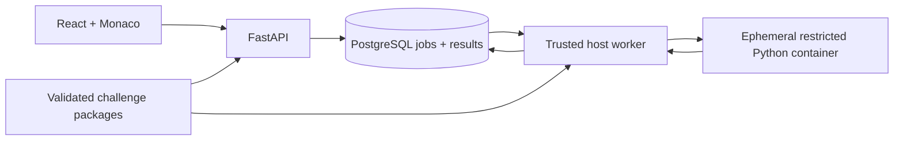

# Architecture

The local browser loads a React/TypeScript application. Vite (development) or Nginx (built mode) proxies `/api/v1` to FastAPI. PostgreSQL stores content identities, immutable version hashes, executions and case results. Monaco assets and workers are bundled locally; submitted code is not sent to any external provider.

FastAPI only validates, persists, and returns data. It neither executes Python submissions nor contacts Docker. The host worker is the only component with Docker access. Compose never mounts the Docker socket into the API.

## Durable lifecycle

A POST carries the challenge slug, immutable content version, action, and up to 32 KiB of UTF-8 code. The API rejects stale content, an unavailable worker, or a full queue. A PostgreSQL transaction lock serializes capacity checks and insertion. It then returns HTTP 202 with a stable UUID.

The worker claims one queued row with `FOR UPDATE SKIP LOCKED`, commits `running`, and performs container execution outside the database transaction. It persists the terminal status and per-case evidence together. Polling retrieves status; submission history survives application and worker restarts. Running jobs interrupted for 60 seconds and queued jobs older than five minutes become infrastructure errors and retain their source for an explicit retry.

Statuses: `queued`, `running`, `passed`, `failed`, `timed_out`, `execution_error`, `infrastructure_error`. Run and Submit use the same durable job structure with an explicit action discriminator.

## Content and correctness

Each folder is validated at startup. Its digest covers metadata, problem, starter, public/private fixtures, hints, reference, and explanation. API and worker must agree on the exact digest; the worker refuses to grade against a different revision. Historical submissions keep their foreign key to the original version. The current-version progress query never grants completion for old content.

Only kwargs enter the sandbox. Test expectations and grading run outside it. The bridge reports JSON values, exception types, bounded output, and input mutation. The worker compares types, structure, and numeric values at absolute tolerance 1e-9. There is no model-based grading.

Private names, expected/actual values, exceptions, and captured output are redacted from all learner API views. The bridge and fixtures are not protected from the local machine owner. Do not mistake this architecture for tamper-proof examination infrastructure.

## Data model

`Track` → `Challenge` → `ChallengeVersion` → `Submission` → `TestResult`.

`WorkerHealth` supplies a recent availability signal. Progress is derived from recorded events rather than a separately mutable completion counter. Each submission has exactly one execution; separate attempts/runs/mastery tables would duplicate the MVP lifecycle. Future labs and design submissions will add their own models and migrations.
